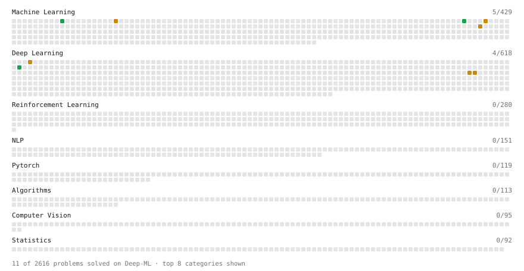

# Deep-ML

My machine learning practice from [Deep-ML](https://www.deep-ml.com). Every solution here was written by hand.

**14** solved · 14 problems · 0 labs · 0 math

[**Browse the interactive portfolio**](https://anaskhmiri13-oss.github.io/deep-ml/) to replay this filling in over time.

## Problems

| | Difficulty | Solved | |
| --- | --- | --- | --- |
| [Backward Pass of Tanh Using Cached Output](https://www.deep-ml.com/problems/999) | easy | 2026-11-26 | [solution](problems/0999-backward-pass-of-tanh-using-cached-output) |
| [Batch Iterator for Dataset](https://www.deep-ml.com/problems/30) | easy | 2026-11-23 | [solution](problems/0030-batch-iterator-for-dataset) |
| [Calculate Number of Parameters in Neural Network](https://www.deep-ml.com/problems/371) | easy | 2026-11-21 | [solution](problems/0371-calculate-number-of-parameters-in-neural-network) |
| [Compute a Gradient with PyTorch Autograd](https://www.deep-ml.com/problems/884) | easy | 2026-11-26 | [solution](problems/0884-compute-a-gradient-with-pytorch-autograd) |
| [Gradient Direction and Magnitude](https://www.deep-ml.com/problems/308) | easy | 2026-11-21 | [solution](problems/0308-gradient-direction-and-magnitude) |
| [Backpropagation Gradients for a Dense Layer](https://www.deep-ml.com/problems/1076) | medium | 2026-11-25 | [solution](problems/1076-backpropagation-gradients-for-a-dense-layer) |
| [Backpropagation Through a Scalar Chain Network](https://www.deep-ml.com/problems/1075) | medium | 2026-11-25 | [solution](problems/1075-backpropagation-through-a-scalar-chain-network) |
| [Chain Rule for Composite Functions](https://www.deep-ml.com/problems/214) | medium | 2026-11-24 | [solution](problems/0214-chain-rule-for-composite-functions) |
| [Find Captain Redbeard's Hidden Treasure](https://www.deep-ml.com/problems/127) | medium | 2026-11-21 | [solution](problems/0127-find-captain-redbeard-s-hidden-treasure) |
| [Implement Gradient Descent Variants with MSE Loss](https://www.deep-ml.com/problems/47) | medium | 2026-11-24 | [solution](problems/0047-implement-gradient-descent-variants-with-mse-loss) |
| [Implementing Basic Autograd Operations](https://www.deep-ml.com/problems/26) | medium | 2026-11-26 | [solution](problems/0026-implementing-basic-autograd-operations) |
| [Numerical Gradient Checking](https://www.deep-ml.com/problems/313) | medium | 2026-11-25 | [solution](problems/0313-numerical-gradient-checking) |
| [Single Neuron with Backpropagation](https://www.deep-ml.com/problems/25) | medium | 2026-11-23 | [solution](problems/0025-single-neuron-with-backpropagation) |
| [Stochastic Gradient Descent Step for Linear Regression](https://www.deep-ml.com/problems/802) | medium | 2026-11-23 | [solution](problems/0802-stochastic-gradient-descent-step-for-linear-regression) |

---

_This file is regenerated by Deep-ML on every push._
